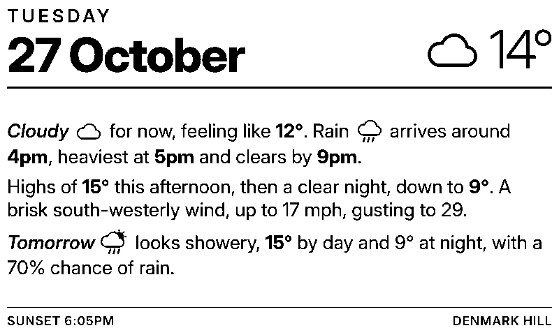

# TRMNL written forecast

The day's weather written out in a few sentences under a large date, with small weather icons in the text. Data from [Open-Meteo](https://open-meteo.com), free and with no key.

*Drawn from the sample answer in `tests/fixtures`, not real weather.*

## What it says

- **Now:** the weather in a word or two and the feels-like temperature.
- **Rain:** when it arrives, when it's heaviest and when it clears, or that it should stay dry. Showers are called showers.
- **Temperature:** the high still to come today, then whether the night is clear, partly cloudy or cloudy, and the low.
- **Wind:** from light winds to a gentle breeze, brisk, strong or gale-force, where it's from, the top speed and gusts.
- **Tomorrow:** the weather, high and low, and the chance of rain if it's 30% or more.
- **Footer:** the next sunset, or sunrise if it's already dark.

It describes from now until 7am tomorrow (or until 6pm if it's the small hours). "Wet" means at least 0.1 mm in an hour or a 50% chance, as on the weather screen.

## How it's used

The Cloudflare server in `../trmnl-server` shows it in place of the weather screen from 6 to 9am, and as a step in the button cycle (weather, transport, radar, forecast). It's also a valid TRMNL private plugin with a full-screen layout.

## Files

| File | What it is |
|---|---|
| `src/settings.yml` | Polling URL and form fields (location, place name). |
| `src/shared.liquid` | Works out the sentences from the forecast, plus the icons and styles. |
| `src/full.liquid` | The full-screen layout. |
| `tests/fixtures/open-meteo.json` | A sample Open-Meteo answer. |
