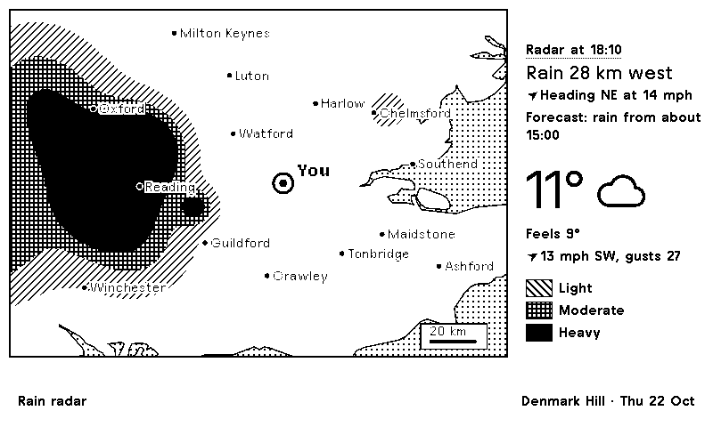

# TRMNL rain radar

A full-screen rain radar map for Champion Grove, SE5 (Denmark Hill), with how far away the nearest rain is, when the forecast says rain will start or stop, the temperature and the wind.

*Drawn from sample radar in `tests/fixtures`, not real weather.*

## What's on the screen

- **Map.** About 210 km by 150 km of South East England, centred on you. Land is white, sea is dotted, and a few towns are labelled so you can tell where the rain is. A 20 km scale bar sits in the corner.
- **Rain.** The latest radar picture from [RainViewer](https://www.rainviewer.com) (free, no key), in three patterns: stripes for light, a grid for moderate, solid black for heavy.
- **Side panel.** The radar's time, how far and which way the nearest rain is ("Rain 28 km west", "Raining here", "No rain on the map"), which way the rain is heading and how fast ("Heading NE at 14 mph"), the forecast's next start or stop time, temperature with a weather icon, feels-like, and wind with gusts from [Open-Meteo](https://open-meteo.com).
- **Rain movement.** Worked out by comparing the newest radar picture with one from about 30 minutes earlier and finding the shift that lines them up best. It's left off when there's too little rain on the map to tell, and says "Rain barely moving" below 3 mph.

## How it's used

It's meant for the Cloudflare server in `../trmnl-server`, which shows it automatically: when rain is near, the TRMNL swaps between this map and the weather every 15 minutes. The button steps weather, transport, radar, so you can also bring the radar up when it is dry. The server README has the details.

It's also a valid TRMNL private plugin (strategy Polling, the two URLs and two fields in `src/settings.yml`, `src/shared.liquid` in Shared, `src/full.liquid` in Full). It only has the full-screen layout.

## Settings

| Field | What it does |
|---|---|
| Location | `latitude,longitude` for the centre of the map. Default `51.4660,-0.0880`. On the server, the `LOCATION` variable. |
| Place name | Shown in the title bar. Default "Denmark Hill". On the server, `PLACE_NAME`. |

## Good to know

- The map is drawn in the browser from RainViewer's map tiles and a built-in coastline (Natural Earth), so there are no images to host.
- If the radar tiles can't be read pixel by pixel, the rain is shown as plain dark shapes without the light/moderate/heavy patterns.
- Not yet tried against live RainViewer and Open-Meteo answers; the patterns depend on RainViewer's colour scheme 2.

## Files

| File | What it is |
|---|---|
| `src/settings.yml` | Polling URLs and form fields. |
| `src/shared.liquid` | Rain timing, the coastline data and the script that draws the map. |
| `src/full.liquid` | The full-screen layout. |
| `tests/fixtures/` | Sample RainViewer and Open-Meteo answers and made-up radar tiles (`tiles-old` is the same rain shifted, for the movement check). |
