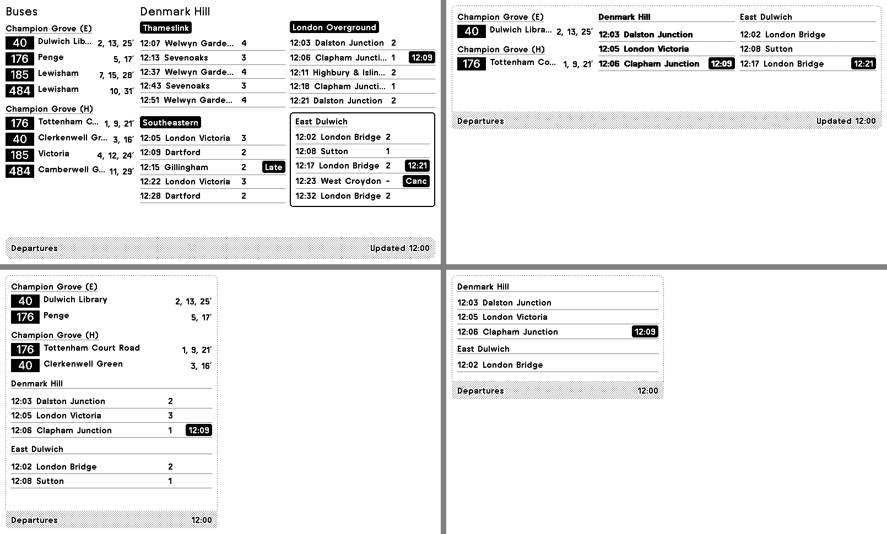

# TRMNL departures: TfL buses + National Rail trains

A TRMNL private plugin that shows, on one screen, the next buses at your stops (by route, in minutes), one station's trains split by operator, and a second station's trains. It's set up for Denmark Hill (Thameslink, London Overground, Southeastern) and East Dulwich. It polls the TfL and Rail Data Marketplace APIs directly, so you don't need a server.



*Rendered with TRMNL's own previewer and design framework from the sample data in `tests/fixtures`. The fonts differ slightly from a real device.*

## Preview it on your computer (no device needed)

TRMNL publishes an official local previewer, **trmnlp**. It draws the screen in your browser exactly as the device will and redraws it each time you save a file.

1. **Install [Docker Desktop](https://www.docker.com/products/docker-desktop/)** and start it. Alternatively, if you have Ruby 4.0+, run `gem install trmnl_preview`.
2. **Download this folder** (or `trmnl-transport.zip` next to it) and open a terminal in it.
3. **See it with sample data, no keys needed:**
   ```sh
   ./bin/trmnlp test --update
   ```
   This draws all four layouts from `tests/fixtures` and saves the pictures in `tests/snapshots/`.
4. **See it with live data:** edit `.trmnlp.yml` and fill in `rail_api_key` (see below). Then run:
   ```sh
   ./bin/trmnlp serve
   ```
   and open <http://localhost:4567>. Edits to anything in `src/` show up straight away.

On Windows, run these from WSL or Git Bash, or use the plain Docker command in the [trmnlp README](https://github.com/usetrmnl/trmnlp#installing-via-docker).

`./bin/trmnlp lint` checks the markup against TRMNL's rules. It currently passes.

## Keys and IDs

**National Rail key (required, free).** Sign up at <https://raildata.org.uk>, subscribe to the **Live Departure Board** product (publisher: Rail Delivery Group), and copy the **Consumer key** from its *Specification* tab. If the endpoint shown there differs from the one in `src/settings.yml`, use theirs.

**TfL.** Arrivals work without a key.

**Bus stop IDs.** Find each stop on tfl.gov.uk and open its live arrivals page. The ID is in the URL: `tfl.gov.uk/bus/stop/490012345N/...`. Put them in `bus_stop_1` and `bus_stop_2` (one each: TfL answers 404 if you ask for several stops in one request). It's set to Champion Grove stop E (`490004972S`, southbound) and stop H (`490004972N`, northbound).

**Stations.** `station_crs` (default `DMK`, Denmark Hill) is split into one block per operator listed in `station_operators`. Names must match National Rail's, e.g. `Thameslink, London Overground, Southeastern`. Leave it blank for one plain list. `second_station_crs` (default `EDW`, East Dulwich) takes the last cell of the two-by-two grid, so the main station gets three quarters of the train space.

## Put it on your TRMNL

When the device arrives, either:

- **From the terminal:** run `./bin/trmnlp login` (it asks for your API key from your TRMNL account page), then `./bin/trmnlp push`. This creates the private plugin with all four layouts. Fill in the form fields on the plugin's settings page.
- **By hand:** on trmnl.com, go to Plugins → Private Plugin → New and use the values in `src/settings.yml`:
  - strategy: Polling
  - polling URLs and the `x-apikey` header
  - form fields: paste the `custom_fields` section into the form builder

  Then paste `src/shared.liquid` into **Shared** and each other `.liquid` file into the layout of the same name.

## Files

| File | What it is |
|---|---|
| `src/settings.yml` | Plugin settings: polling URLs, header, form fields. Uploaded to TRMNL. |
| `src/shared.liquid` | Data prep plus the `buses` and `trains` blocks every layout uses. |
| `src/full.liquid` etc. | One per layout: full screen, half (both ways), quadrant. |
| `.trmnlp.yml` | Your values for local preview only. Holds your key, so don't share it. |
| `tests/` | Sample API answers and a test that draws every layout from them. |

## Tweaking

Row counts are set where each layout calls the blocks, e.g. `max_routes: 4` per bus stop and `per_operator: 5` in `src/full.liquid`. `hide_under_mins: 1` drops buses you can no longer catch. Trains running on time show no status; late or cancelled ones show it inverted.

## Still to confirm against live data

The previewer showed that TRMNL wraps each TfL response as `IDX_0.data` and `IDX_1.data`, and the markup handles that. The rail URL is confirmed from the marketplace. One thing can only be checked with live data:

- that disruption notices really arrive as `nrccMessages[].Value`.
