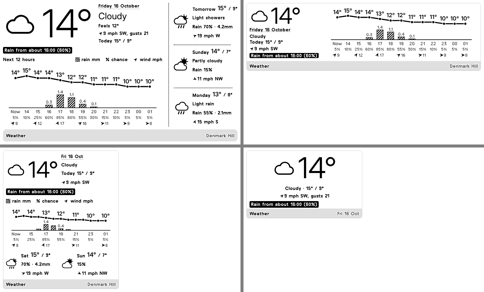

# TRMNL weather: today, next 12 hours, days ahead

A TRMNL private plugin that shows the weather right now with when rain is due, a combined temperature and rain chart for the next 12 hours, and the forecast for the next three days (two in the half-size layout). It's set up for Champion Grove, SE5 (near Denmark Hill). The data comes from [Open-Meteo](https://open-meteo.com), which is free and needs no key or server.

*Drawn from the sample answer in `tests/fixtures` with TRMNL's design framework. The fonts differ slightly from a real device.*

## What's on the screen

- **Now.** Temperature, icon, a few words, feels-like, today's high and low, and wind: speed, where it's from (e.g. SW) with an arrow pointing the way it's blowing, and gusts on the full and quarter-size layouts. There's no clock: TRMNL only redraws the screen when it fetches new data (every 15 minutes here), so a time would always be stale. The date sits above the current conditions.
- **Rain line.** If it's dry: "Rain from about 16:00 (60%)", the first hour in the next 24 with at least 0.1 mm or a 50% chance. If it's raining: "Raining, dry from about 19:00". Otherwise "No rain in the next 24 hours".
- **Chart.** One column per hour from now. The line is temperature. Bars are the rain expected in that hour, in mm, with the amount written on top. The scale runs to 2 mm, or to the wettest hour if that's more. The chance of rain is the percentage under each hour, and under that an arrow and mph show the wind every two hours (every four on the narrow layout). The arrow points the way the wind is blowing.
- **Next three days** (two in the half-size layout). High and low, icon, words, the day's highest chance of rain and the total expected, and the day's top wind speed with its main direction. The narrow layout leaves out the words to fit.

Icons are drawn in SVG inside the markup, so there are no images to host and they stay sharp on the e-ink screen.

## Preview it on your computer (no device needed)

Same as the departures plugin:

1. Install [Docker Desktop](https://www.docker.com/products/docker-desktop/) and start it (or, with Ruby 4.0+, `gem install trmnl_preview`).
2. Open a terminal in this folder.
3. With the sample data: `./bin/trmnlp test --update` saves pictures of all four layouts in `tests/snapshots/`.
4. With live data: `./bin/trmnlp serve`, then open <http://localhost:4567>. No key is needed.

`./bin/trmnlp lint` checks the markup against TRMNL's rules.

## Put it on your TRMNL

- **From the terminal:** `./bin/trmnlp login`, then `./bin/trmnlp push`. This creates the private plugin with all four layouts.
- **By hand:** on trmnl.com, go to Plugins → Private Plugin → New and use the values in `src/settings.yml` (strategy Polling, the polling URL, and the two form fields). Paste `src/shared.liquid` into **Shared** and each other `.liquid` file into the layout of the same name.

Add it to a playlist next to the departures screen, or put both in a mashup: the `half_horizontal` and `half_vertical` layouts are for that.

## Settings

| Field | What it does |
|---|---|
| Location | A place search on TRMNL, or `latitude,longitude`. Default `51.4660,-0.0880` (Champion Grove, SE5). |
| Place name | Shown in the title bar. Default "Denmark Hill". |

Times come back in the location's own time zone (`timezone=auto`).

## Tweaking

- Columns in the chart: `hours: 13` where each layout calls `rain_temp_chart` (13 columns is now plus 12 hours). `wind_every: 2` sets how often the wind row shows; leave it out for no wind row.
- What counts as rain: the `0.1` mm and `50`% thresholds near the top of `src/shared.liquid`.
- Bar scale: the `2` mm minimum in `rain_temp_chart`.
- Wind is in mph (`wind_speed_unit=mph` in the polling URL). Drop that parameter for km/h.

## Files

| File | What it is |
|---|---|
| `src/settings.yml` | Plugin settings: polling URL and form fields. Uploaded to TRMNL. |
| `src/shared.liquid` | Rain timing, the icons, the chart and the day block every layout uses. |
| `src/full.liquid` etc. | One per layout: full screen, half (both ways), quadrant. |
| `.trmnlp.yml` | Your values for local preview only. |
| `tests/` | A sample Open-Meteo answer and a test that draws every layout from it. |
